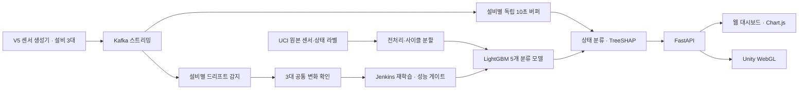
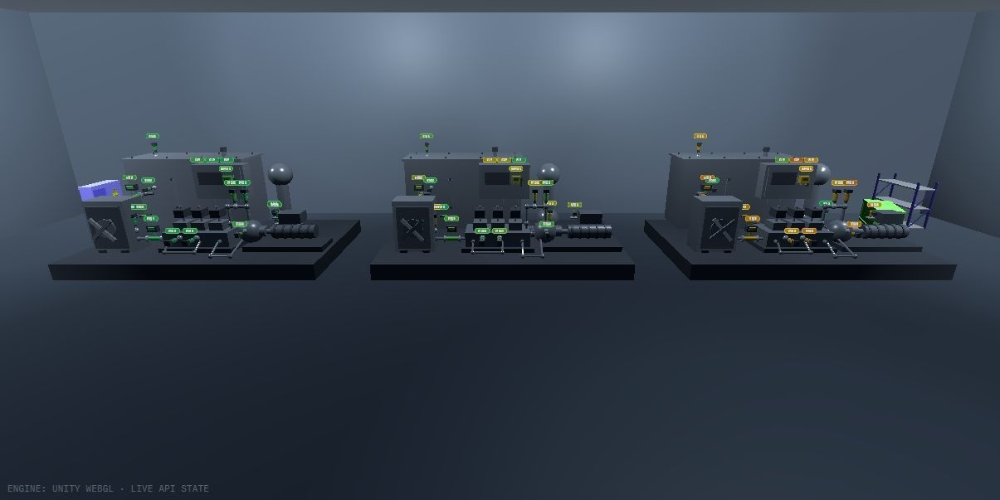
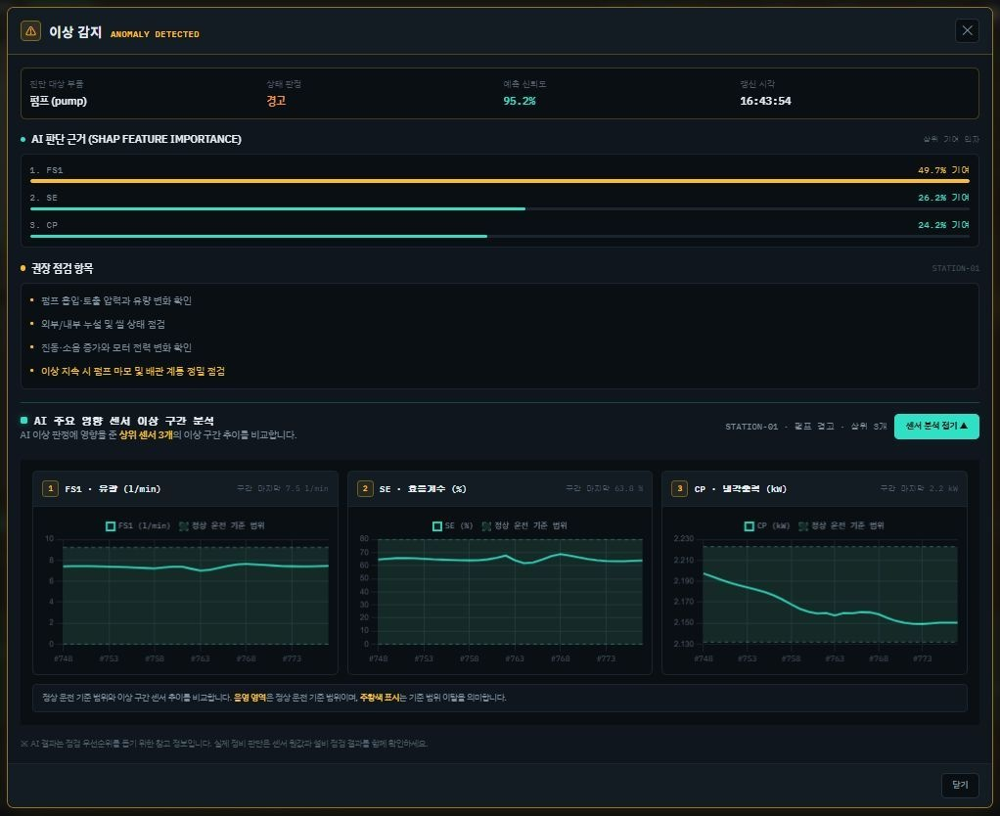

# 💧 HydroTwin

**17개 유압 센서의 최근 10초 데이터로 부품 상태를 판별하고, 주요 영향 센서를 설명하는 디지털 트윈 관제 프로젝트입니다.**

냉각기·밸브·펌프·축압기의 상태를 LightGBM으로 분류하고 TreeSHAP으로 판단에 기여한 센서를 제공합니다. Kafka로 전달되는 설비 3대의 데이터를 웹 대시보드와 Unity WebGL 화면에서 확인합니다.

> 팀 프로젝트 결과물을 **홍유나의 개인 포트폴리오**로 정리한 복사본입니다. 전체 시스템은 팀 공동 결과물이며, 개인 담당은 데이터 분석·전처리, 모델 학습·평가, SHAP 영향 센서 분석과 UI/UX 디자인입니다.

## 프로젝트 개요

| 항목 | 내용 |
| --- | --- |
| 프로젝트 | HydroTwin · 유압 설비 상태 판별 및 영향 센서 분석 |
| 개발 기간 | 2026.08.28 ~ 2026.09.15 |
| 구성 | 4인 팀 프로젝트 |
| 포트폴리오 작성자 | 홍유나 |
| 데이터 | UCI Condition Monitoring of Hydraulic Systems · 2,205 사이클 · 사이클당 60초 · 17개 센서 |
| AI 입력 | 최근 10초 센서별 평균값 17개 |
| AI 출력 | 냉각기·밸브·펌프·축압기 상태와 안정 여부 |

기간과 담당 범위는 [팀 마일스톤](docs/team-milestones.md), [상세 작업 명세](docs/team-task-board.md), [최종 발표자료](docs/HydroTwin%20프로젝트%20최종%20발표자료%20%28수정%20완성본%29.pdf)를 기준으로 작성했습니다.

## 홍유나 담당 업무

| 담당 영역 | 구현·검토 내용 | 관련 코드·자료 |
| --- | --- | --- |
| 데이터 분석·EDA | 센서별 분포·상태 라벨 분석, 수집 주기와 특징 검토 | [EDA 노트북](notebooks/01_data_analysis.ipynb) |
| 전처리·특징 추출 | 100Hz·10Hz·1Hz 센서의 10초 구간 평균 추출, 17개 입력 특징 통일 | [통합 파이프라인](src/hydrotwin_pipeline.py) |
| 학습 데이터 구성 | 사이클 ID 기반 70:15:15 분할, 동일 사이클 구간의 데이터 누수 방지 | [파이프라인](src/hydrotwin_pipeline.py) |
| 모델 개발·평가 | ExtraTrees·LightGBM·RandomForest·XGBoost 비교, 정확도·Macro F1·혼동행렬 평가 | [학습 노트북](notebooks/02_model_training.ipynb) · [평가 노트북](notebooks/03_model_evaluation.ipynb) |
| SHAP 영향 센서 분석 | 부품별 TreeSHAP 기여도 분석과 주요 영향 센서 비교 | [오프라인 설명](src/model/explain.py) · [통합 파이프라인](src/hydrotwin_pipeline.py) |
| 관제 화면 UI/UX | 이상 상세 팝업과 주요 영향 센서 3개 그래프, 정상 복귀 후에도 이상 구간 기록을 유지하는 화면 구현 | [관제 화면](web/index.html) · [최종 발표자료의 역할표](docs/HydroTwin%20프로젝트%20최종%20발표자료%20%28수정%20완성본%29.pdf) |

링크는 담당 영역이 반영된 현재 코드 위치입니다. 시스템 연동 및 팀 통합 수정도 포함되어 있어 파일 전체를 개인 단독 작성으로 표시하는 의미는 아닙니다. 10초 이동 구간 생성([rolling.py](src/features/rolling.py))과 회귀 검사([test_rolling_training.py](tests/test_rolling_training.py)), 실시간 진단의 `pred_contrib` 영향 센서 계산([inference.py](src/runtime/inference.py))은 팀원 조현재가 구현했습니다.

## 주요 구현 경험

### 1. 학습과 실시간 추론의 입력을 일치시킨 데이터 파이프라인

센서별 수집 주기가 달라 동일한 10초 구간에서도 데이터 개수가 다릅니다. 압력·전력은 100Hz, 유량은 10Hz, 온도·진동·효율 관련 센서는 1Hz로 수집됩니다. EDA에서 여러 통계 특징을 검토한 뒤 최종 서비스 입력을 **센서별 평균값 17개**로 통일했습니다.

학습·재학습·실시간 추론에서 동일한 센서 순서와 특징 이름을 사용하며, 냉각기·밸브·펌프·축압기와 안정 여부를 위한 5개 분류기를 특징·라벨 메타데이터와 함께 하나의 joblib 번들로 관리합니다.

### 2. 구간을 늘려도 평가 데이터가 섞이지 않는 사이클 단위 분할

현재 파이프라인은 60초 사이클 안에서 10초 구간을 1초씩 이동해 **51개 위치**를 학습에 사용합니다. 구간 경계는 원본 사이클을 넘지 않습니다. 이동 구간 생성은 팀원 조현재가 추가했고, 아래의 사이클 단위 분할은 홍유나가 통합 파이프라인에 구현했습니다.

겹치는 구간을 무작위로 나누면 거의 같은 데이터가 학습과 테스트에 동시에 들어갈 수 있어, 먼저 **사이클 ID를 70:15:15로 분리**하고 해당 사이클의 모든 구간을 같은 데이터셋에 배정합니다. 축압기 상태를 기준으로 층화 분할하고 5개 타깃이 같은 사이클 분할을 사용합니다. 상태 라벨을 입력 특징에 포함하지 않고 중복 구간도 검사합니다.

### 3. 정확도와 응답 시간을 함께 고려한 모델 선정

최종 발표자료에 보고된 검증 결과는 다음과 같습니다.

| 지표 | LightGBM | RandomForest |
| --- | ---: | ---: |
| Accuracy | 0.9909 | 0.9932 |
| Macro F1 | 0.9879 | 0.9913 |
| 평균 추론 시간 | 2.87ms | 49.11ms |

RandomForest가 분류 지표에서는 소폭 우세했지만, LightGBM의 평균 추론 시간이 약 17배 짧아 실시간 관제와 SHAP 분석 연계를 고려해 최종 서비스 모델로 선택했습니다.

**위 수치는 팀 최종 발표자료의 검증 결과입니다.** 이번 포트폴리오 정리에서 모델을 재학습하거나 추론 시간을 다시 측정한 값은 아닙니다. 원본 저장소에는 해당 수치의 전체 측정 환경과 원시 벤치마크 로그가 포함되어 있지 않습니다. 저장소의 [평가 노트북](notebooks/03_model_evaluation.ipynb)에는 20초 구간 기준 LightGBM Accuracy 0.9879, Macro F1 0.9860이 기록되어 있어 발표자료 수치와 차이가 있습니다.

### 4. 상태 판별에 판단 근거를 더한 SHAP 분석

오프라인 분석에서는 센서별 SHAP 기여도를 집계해 주요 영향 센서를 비교합니다(홍유나). 실시간 진단에서는 LightGBM의 `pred_contrib`로 예측 클래스에 대한 TreeSHAP 값을 계산하고, **상위 3개 영향 센서와 클래스 신뢰도**를 상태 결과에 함께 제공합니다(팀원 조현재). 홍유나는 이 결과를 이상 상세 팝업의 영향 센서 3개 그래프로 표시했습니다.

작업자가 이상 상태를 확인한 뒤 관련 센서를 먼저 점검할 수 있도록 결과를 구성했습니다. SHAP은 모델의 판단 근거이며 물리적인 고장 원인을 확정하는 증거는 아닙니다.

## 시스템 전체 구성



- 설비는 `station-01`, `station-02`, `station-03`의 3대이며 센서값은 1초마다 갱신됩니다.
- Kafka 토픽은 `hydraulic.sensor.multi.raw`입니다.
- 처음 10초를 모으는 동안에는 `warming_up`, 메시지가 지연되면 해당 설비는 `stale`로 표시합니다.
- 재학습은 검증된 기존 라벨 데이터와 계절 변화 offset을 사용합니다. 실시간 예측을 정답 라벨로 사용하지 않습니다.
- 원본 환경과 계절 변화 환경의 성능 기준을 모두 통과한 후보만 운영 모델로 교체합니다.

이 항목은 **팀 전체 시스템의 기능**입니다. 개인 역할과 전체 기능은 아래 역할표에서 구분했습니다.

## 팀 구성

| 이름 | 주요 담당 |
| --- | --- |
| 조현재 | PM, 일정 관리, Unity 3D·WebGL, API 규격 협의, 시스템 통합 |
| **홍유나** | **데이터 분석·EDA·전처리·특징 추출, 모델 학습·평가, SHAP, UI/UX 디자인** |
| 박민 | FastAPI, Kafka Producer·Consumer, 웹 UI·Chart.js, 실시간 연동 |
| 신종건 | Docker·Compose, Jenkins CI/CD, pytest, MLOps 운영 환경 |

## 주요 화면

다음 이미지는 **팀 최종 발표자료에 포함된 실제 프로젝트 화면**에서 추출했습니다. 이번 정리 중 새로 실행하거나 촬영한 화면은 아닙니다. 화면 전체는 팀 공동 결과물입니다.

### Unity WebGL 설비 관제



### 이상 알림과 주요 영향 센서



## 기술 스택

| 구분 | 기술 |
| --- | --- |
| 개인 데이터·AI 영역 | Python · pandas · NumPy · scikit-learn · LightGBM · SHAP · Parquet · joblib |
| 스트리밍·API | Kafka · kafka-python · FastAPI · Uvicorn |
| 화면·3D | HTML · CSS · JavaScript · Chart.js · Unity · WebGL |
| 생성 모델 | Keras · JAX |
| 운영·협업 | Docker · Docker Compose · Jenkins · pytest · Git · GitHub |

원본 의존성 버전은 [requirements.txt](requirements.txt)에 보존했습니다. 최종 웹 구현은 HTML·JavaScript·Chart.js이며, 일부 기획 문서에 기재된 React·Tailwind를 실제 사용 기술로 표시하지 않았습니다.

## 실행 방법

### 준비할 데이터와 모델

이 저장소만 복제해서 전체 서비스를 바로 실행할 수는 없습니다. 원본에서 Git으로 관리하지 않은 학습 자산을 준비해야 합니다.

1. [UCI 데이터셋](https://archive.ics.uci.edu/dataset/447/condition+monitoring+of+hydraulic+systems)의 센서별 TXT와 `profile.txt`를 `data/raw/uci_hydraulic/extracted/`에 준비합니다.
2. Python 의존성을 설치한 뒤 최초 전처리와 모델 학습을 실행합니다.

```bash
pip install -r requirements.txt
python -m src.runtime.bootstrap
```

`bootstrap`은 1Hz 센서 데이터와 10초 특징을 생성하고, 모델이 없으면 상태 분류 모델을 학습합니다. 원본에 이미 공개된 V5 생성 모델 파일과 WebGL 빌드는 복사본에도 유지했습니다. Unity 편집용 프로젝트는 포함되어 있지 않습니다.

### Docker로 통합 실행

Docker Desktop과 필수 자산을 준비한 뒤 Windows PowerShell에서 실행합니다.

```powershell
.\start.ps1
```

- 웹·Unity: `http://localhost:8000`
- 서버 상태: `http://localhost:8000/health`
- 최신 설비 상태: `http://localhost:8000/api/v1/state/latest`
- 센서 정상 범위: `http://localhost:8000/api/v1/sensors/reference-bands`
- Jenkins: `http://localhost:8080`

중지할 때는 `docker compose stop`을 사용합니다. 상세 설정과 로컬 자산 경로는 [원본 실행 가이드](docs/local-runtime.md)에 있습니다. 가이드의 `dev` 브랜치 자동 배포 설정은 팀 개발 환경용이며, 이 포트폴리오 `main` 저장소의 자동 배포를 설정한 것은 아닙니다.

## 폴더 구조

```text
api/                     FastAPI 상태 API·정적 화면 제공
kafka/                   센서 생성·수신·추론 연동
notebooks/               EDA·학습·평가 노트북
src/hydrotwin_pipeline.py 통합 전처리·분할·학습·평가·SHAP
src/features/            사이클 내 10초 이동 구간
src/runtime/             실시간 진단·드리프트·학습 작업
src/model/               모델 실행 진입점·재학습 성능 게이트
src/simulator/           시계열 생성 모델·다중 설비 시나리오
src/monitoring/          드리프트·센서 정상 범위
web/                     관제 화면·Unity WebGL 빌드
tests/                   데이터·API·드리프트·화면 회귀 검사
docs/                    팀 문서·발표자료·포트폴리오 출처
```

## 포트폴리오 정리 및 확인 범위

- 원본 `master`의 고정 커밋을 스냅샷으로 복사하고 애플리케이션 코드는 유지했습니다.
- README, 출처 기록, 발표자료에서 추출한 화면 2장을 추가했습니다.
- 재학습 성능 게이트·드리프트·센서 정상 범위 관련 Python 테스트 **15개**, 웹 설비 상태·센서 범위 JavaScript 테스트 **6개**의 통과를 확인했습니다.
- 전체 ML 의존성 환경, 모델 재학습·성능 재측정, Kafka·Docker·Jenkins·Unity 통합 실행은 이번 정리에서 검증하지 않았습니다.

기준 커밋, 원본 파일 보존 범위와 검사 환경은 [출처와 검증 기록](docs/SOURCE.md)에 정리했습니다.

## 관련 자료

- [원본 팀 저장소](https://github.com/yuudong123/ai-first-project/tree/master)
- [개발 당시 README](docs/README.original.md)
- [팀 마일스톤](docs/team-milestones.md) · [상세 작업 명세](docs/team-task-board.md)
- [프로젝트 조사·설계 문서](docs/project-research.md)
- [최종 발표자료](docs/HydroTwin%20프로젝트%20최종%20발표자료%20%28수정%20완성본%29.pdf)
- [원본 출처와 확인 기록](docs/SOURCE.md)

원본 UCI 데이터셋은 CC BY 4.0입니다. 팀 코드와 자료에는 새로운 라이선스를 부여하지 않았으며 원본 출처를 유지합니다.


## 프로젝트 회고

### 정상 복귀 시 사라지는 이상 팝업과 센서 분석 정보 개선

관제 화면의 이상 알림은 실시간 상태가 정상으로 돌아오면 팝업을 자동으로 닫았습니다. 상세 분석도 계속 바뀌는 최신 센서 이력을 사용하고 있어, 사용자가 이상을 확인하려는 시점에는 알림이 사라지거나 당시의 센서 구간을 보기 어려운 구조였습니다. 실시간 상태를 갱신하는 것과 이미 발생한 이상을 분석하는 흐름을 따로 고려할 필요가 있었습니다.

팝업이 열린 순간의 설비, 부품, 위험도와 상위 영향 센서를 별도 기록하도록 변경했습니다. 이상이 진행되는 동안 센서값을 추가하되, 같은 이벤트를 여러 번 폴링해도 중복 저장하지 않도록 했습니다. 정상으로 복귀하면 수집만 종료하고 팝업과 이상 구간 데이터는 사용자가 닫을 때까지 보관했습니다. 상세 그래프도 저장한 구간을 사용하도록 바꾸고, 설비를 변경하면 이전 설비의 팝업과 기록을 정리하도록 수정했습니다.

이 과정에서 실시간 화면은 최신 값을 보여 주는 기능뿐 아니라 사용자가 상황을 이해할 시간을 보장해야 한다는 점을 느꼈습니다. 상태가 정상으로 바뀌어도 이미 발생한 이상을 검토할 수 있도록, 현재 상태와 사건 기록의 수명을 구분하는 것이 중요했습니다.

관련 변경: [이상 팝업 유지와 이상 구간 센서 분석](https://github.com/yuudong123/ai-first-project/commit/16d922802879a32ac0a2a493d7fad917234c7580)

### 모델 비교에서 데이터 분할 기준을 일치시킨 경험

센서의 수집 주기가 다르고 특징을 만드는 시간 구간도 달라, 모델을 비교할 때 입력 데이터와 평가 기준을 먼저 맞춰야 했습니다. 학습 노트북에서는 같은 사이클 분할을 여러 시간 구간에 사용하도록 구성했고, 통합 파이프라인에서는 사이클 ID를 기준으로 학습·검증·테스트를 70:15:15로 나누어 모든 타깃이 같은 분할을 사용하도록 정리했습니다. 분할 간 사이클 중복과 전체 데이터 포함 여부를 확인하고 분할 ID도 저장했습니다.

현재처럼 한 사이클에서 겹치는 여러 구간을 만들 때는 비슷한 구간이 학습과 테스트에 동시에 들어가면 성능을 실제보다 높게 평가할 위험이 있습니다. 따라서 구간 수를 늘리는 것보다 먼저 사이클 단위 분할을 유지하는 것이 중요하다고 배웠습니다. 모델의 정확도만 비교하는 데서 그치지 않고, 어떤 데이터와 조건에서 나온 결과인지 설명하는 능력도 필요하다고 느꼈습니다.

관련 변경: [시간 구간 비교와 사이클 분할](https://github.com/yuudong123/ai-first-project/commit/46d649bcdf164708e60e5c342f0b5f31238c2d12) · [공통 분할·통합 파이프라인 추가](https://github.com/yuudong123/ai-first-project/commit/25f6e1d8a8f33ffb09dad427a94673acda0a24da)

### 앞으로 보완할 부분

이상 구간 기록은 현재 팝업 상태에 보관하므로, 새로고침 이후에도 확인하려면 사건 ID와 발생·종료 시각을 포함한 저장 및 조회 기능이 필요합니다. 짧은 이상, 반복 이벤트, 정상 복귀, 설비 변경을 화면 테스트로 남기고 싶습니다. 모델 평가에서는 분할 ID뿐 아니라 전처리 설정, 모델 버전, 측정 환경과 원시 결과를 함께 저장해 재현성을 높이겠습니다. SHAP 영향 센서는 모델의 판단 근거이므로, 화면에서도 실제 고장 원인으로 단정하지 않도록 설명을 개선하고 싶습니다.
